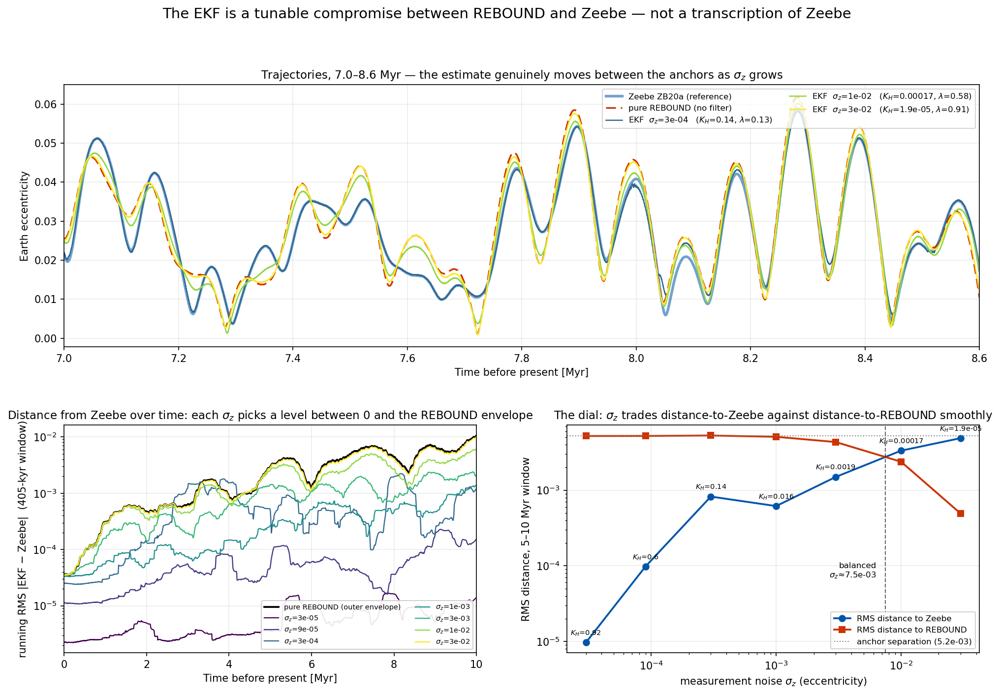
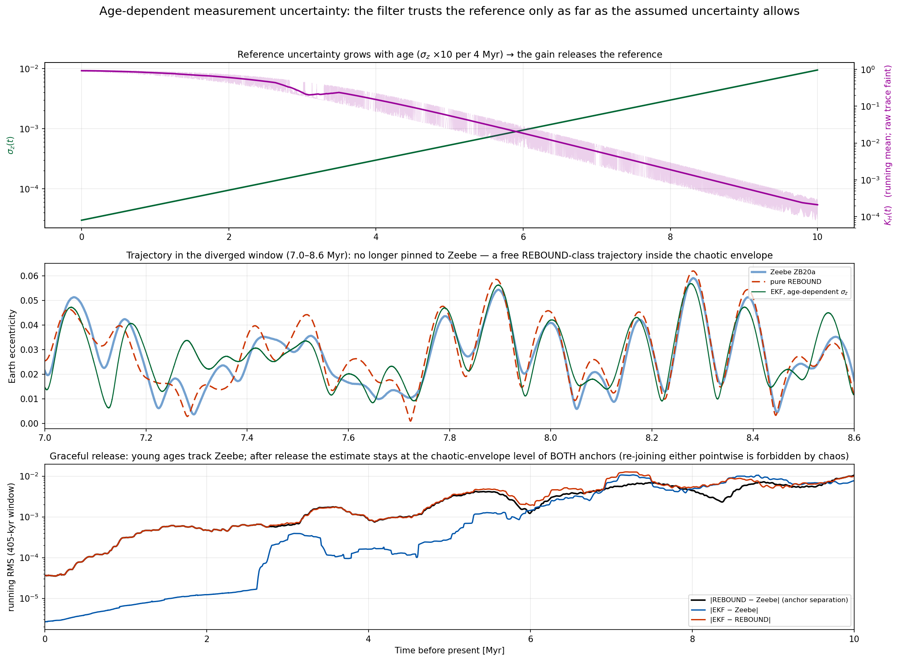

# The EKF is a tunable compromise, not a transcription of Zeebe

**Answer to the "too good to be true" concern — R_ecc sweep + age-dependent uncertainty**
*CycloAstro, July 2026. Run: `results/compromise_sweep/` (script `compromise_sweep.py`, 0–10 Myr, 100-yr cadence, no gating).*

---

## 1. The concern

The production EKF tracks Zeebe ZB20a to |ZB−EKF| ≈ 1.2×10⁻⁵. The natural
objection: *if the filter just sits on the reference, what has been gained?*

The answer: the closeness is a **choice**, set by one physical knob — the
eccentricity measurement covariance R_ecc = σ_z². Turn the knob and the same
filter, unchanged, produces any compromise between the two sources of
information. We demonstrate this two ways below, with the estimate's position
measured against **both** anchors: the Zeebe reference and an independent pure
REBOUND integration (no filter).

## 2. What one number means — and a correction to our earlier demo

The gain along the measured direction is K_H = HPH′/(HPH′ + σ_z²). Our
earlier three-value demo (σ_z = 3/9/30×10⁻⁵ → K_H = 0.92/0.60/0.14) showed
K_H is tunable, but all three trajectories still *looked* glued to Zeebe.
The reason is a real quantitative insight:

> With measurements every 100 yr, corrections accumulate. The steady-state
> offset from Zeebe scales like (model drift per epoch)/K_H, so even
> K_H = 0.14 erases REBOUND's slow drift. **A trajectory that sits midway
> between the anchors requires K_H ≪ 0.5** — the per-update gain and the
> position of the trajectory are different quantities.

We therefore measure the compromise in *trajectory space*: over the 5–10 Myr
window (where the two anchors have visibly separated, RMS separation
5.2×10⁻³) we compute the RMS distance of the estimate to each anchor and the
position fraction **λ = d(Zeebe)/(d(Zeebe)+d(REBOUND))** — λ = 0 means "on
Zeebe", λ = 1 means "on REBOUND".

## 3. The sweep: seven settings of one knob

| σ_z | K_H (mean) | RMS to Zeebe | RMS to REBOUND | λ |
|---|---|---|---|---|
| 3×10⁻⁵ (production) | 0.92 | 9.7×10⁻⁶ | 5.2×10⁻³ | 0.00 |
| 9×10⁻⁵ | 0.60 | 9.8×10⁻⁵ | 5.2×10⁻³ | 0.02 |
| 3×10⁻⁴ | 0.14 | 8.2×10⁻⁴ | 5.3×10⁻³ | 0.13 |
| 1×10⁻³ | 0.016 | 6.2×10⁻⁴ | 5.1×10⁻³ | 0.11 |
| 3×10⁻³ | 1.9×10⁻³ | 1.5×10⁻³ | 4.3×10⁻³ | 0.26 |
| 1×10⁻² | 1.7×10⁻⁴ | 3.3×10⁻³ | 2.4×10⁻³ | 0.58 |
| 3×10⁻² | 1.9×10⁻⁵ | 4.9×10⁻³ | 4.9×10⁻⁴ | 0.91 |

The dial spans the full range: from indistinguishable-from-Zeebe (λ ≈ 0) to
indistinguishable-from-REBOUND (λ = 0.91), with the **balanced trajectory
(equal distance to both anchors) at σ_z ≈ 7.5×10⁻³**. Distances of
neighbouring intermediate settings vary at the chaotic-realization level
(e.g. the 3×10⁻⁴ vs 1×10⁻³ rows), so the dial is smooth only to within that
variance — that is physics, not tuning error.



*Top: in the 7.0–8.6 Myr window the estimate genuinely moves between the
anchors as σ_z grows. Bottom-left: distance from Zeebe over time — each σ_z
picks a level between zero and the pure-REBOUND envelope. Bottom-right: the
dial — RMS distance to each anchor crosses smoothly.*

## 4. Age-dependent uncertainty (the geological version)

A geological reference deserves less trust deeper in time. We ran the same
filter once with **σ_z growing with age**: σ_z(t) = 3×10⁻⁵ × 10^(t/4 Myr)
(×10 per 4 Myr; the rate is an illustrative modeling choice, to be calibrated
when real proxy uncertainties are available). The gain follows automatically:
K_H = 0.96 at present decaying to 2.5×10⁻⁴ at 10 Myr.

The result is a **graceful, automatic hand-off in a single run**: young ages
track Zeebe (distance ~10⁻⁶–10⁻⁵), and as the assumed uncertainty grows the
filter releases the reference (here starting near ~2.5 Myr, complete by
~5 Myr).



**Honest caveat:** after release, the estimate is a *free REBOUND-class
trajectory*. It stays inside the chaotic envelope, but it does not re-join
either anchor point-by-point — two nearby trajectories of the chaotic inner
Solar System separate on the ~5 Myr Lyapunov time, so past the release the
distance to *both* anchors sits at the envelope level (λ = 0.48 in the
5–10 Myr window). This is exactly the behaviour a defensible reconstruction
should have: agreement where the reference is trustworthy, honest
REBOUND-level uncertainty where it is not. It is also the native mechanism
behind our production hand-off to pure REBOUND past ~8 Myr.

## 5. Take-away

- The production setting σ_z = 3×10⁻⁵ is not the filter "cheating off"
  Zeebe; it is the deliberate, physically-motivated end of a continuous,
  demonstrated dial (trust the reference at 3×10⁻⁵ eccentricity where it is
  reliable).
- The same knob, made age-dependent, yields the geologically natural
  behaviour: trust decays with age and the filter hands over to pure dynamics
  automatically.
- When real proxy data with quantified uncertainties arrive (e.g. the
  53–58 Mya window), those σ values plug directly into this same R_ecc slot.

## Reproduce

```
%run "/Users/kasulasan/Projects/The CycloAstro Project/cycloastro_python/cycloastro_tests.py"
%run "/Users/kasulasan/Projects/The CycloAstro Project/cycloastro_python/compromise_sweep.py"
```

(~6 min wall on 8 cores; add `--replot` to regenerate figures from the saved
CSVs without re-running the filters. All parameters, versions and timings are
recorded in `results/compromise_sweep/config.json`.)
